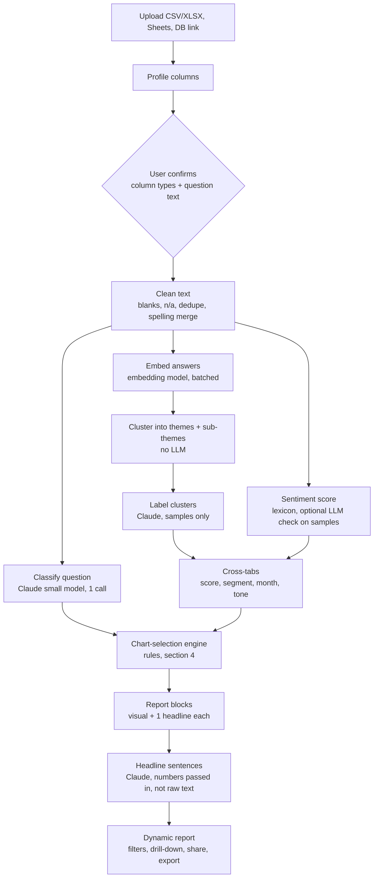

# Verbatim: product and chart-selection spec (draft 1)

## 1. Decisions taken

| Question | Decision | Consequence |
|---|---|---|
| Who uses it | Solo analysts and teams | Accounts, workspaces, roles (owner, editor, viewer), share links from day one |
| Where text is processed | Cloud, using Claude models, cost-optimised | Cheap steps (embeddings, clustering) do the bulk work. Claude only sees small samples. |
| Main deliverable | A dynamic report generator, less text, more visuals | The report is a sequence of visual blocks with one headline sentence each. It is not a dashboard of every chart. |

## 2. Data flow

### Where Claude is used, and where it is not

| Step | Tool | Input size | Notes |
|---|---|---|---|
| Question classification | Small Claude model | Question text plus about 30 sample answers | One call per column |
| Embedding | Embedding model | All answers, batched | Not an LLM call |
| Clustering | Code (HDBSCAN or k-means) | Vectors | Free once vectors exist |
| Theme labels | Claude | About 15 to 25 representative answers per cluster | One batched call for all clusters. Ask for a label, a one-line description, and merge and split suggestions. |
| Sentiment | Lexicon in code | All answers | Claude spot-checks about 100 samples to report scorer agreement |
| Headline sentences | Claude | Aggregated numbers only | No raw answers, so cheap and less risky |
| Re-labelling after user edits | Claude | Only changed clusters | Cache everything else |

Cost controls: cache by file hash and column, use prompt caching for the fixed instructions, use batching, cap samples per cluster, and re-run only what a user edit touches.

## 3. Column profiling

| Type | Detection | Used for |
|---|---|---|
| Open-ended text | Mostly unique values, median 4 or more words | Themes, sentiment |
| Short text | Mostly 1 to 3 words | Ranked counts after merging variants |
| Score | Numeric with small range (0-10, 1-5), or header hints | Score-band charts |
| Date | Parseable, 3 or more distinct periods | Trend |
| Segment | 2 to 12 distinct values, not a score | Heatmap, filters |
| Numeric other | Continuous | Histogram, filters |
| ID or junk | Unique, no meaning | Ignored |

The user sees these as editable chips and can override any of them.

## 4. Chart-selection rules

Inputs: question type (reasons, improvements, experiences, facts, opinions, other), framing, answer style (short or long), theme count, and which optional columns exist.

Every rule is "include if", with a priority. The engine sorts by priority and caps the report at 9 blocks.

| Block | Include if | Priority | Skip when |
|---|---|---|---|
| Overview | Always | 1 | |
| Sunburst | Open-ended text and 2 or more themes | 2 | Fewer than 3 sub-themes in total, use treemap |
| Treemap | Sub-themes greater than 12, or long theme names | 2 (replaces sunburst) | |
| Icicle | Mobile view | 2 (replaces sunburst on mobile) | |
| Rank | Question type is improvements or barriers | 3 | |
| Sentiment sunburst or Marimekko | Framing is not neutral, or sentiment spread is wide | 4 | Sentiment spread under 0.05 |
| Diverge | Reasons with neutral or positive framing | 4 | |
| Sankey | Score column present and 3 or more themes | 5 | |
| Heatmap | Segment column present | 5 | Any segment under 100 answers |
| Trend | Date column with 3 or more periods | 6 | Under 30 answers per period |
| Arc diagram | 4 or more themes and co-mentions above 5% of answers | 7 | |
| Answer map | More than 500 answers | 7 | |
| Bubble map | 3 or more themes, and no answer map | 8 | |
| Ranked counts | Short, factual answers | 2 (replaces sunburst) | |
| Quality | Always, last | 9 | |

Tie-breaks: prefer the chart that carries the most cross-column information (score, segment, date) over one that repeats the theme list.

The engine returns a ranked list. The user can add, hide or reorder blocks, and their choices are saved with the report.

## 5. The dynamic report

Structure: a header sentence, then blocks, then a quality footer.

Each block has:
- One headline sentence generated from the numbers, such as "Charging carries the most negative wording".
- The visual.
- A "see answers" action that opens the real verbatims behind whatever is selected.

Rules for "less text":
- Maximum one headline sentence per block, and no paragraphs.
- Numbers appear on the chart itself, never only in the text.
- Every sentence has a click-through to evidence.

Dynamic behaviours:
- A global filter (segment, score band, date range) recomputes every block from cached cross-tabs. Only theme counts change, so no new model calls.
- Selecting a theme in one chart highlights it in all charts (others dim to 28%).
- Editing a theme (rename, merge, split) updates the whole report.

Sharing:
- Roles: owner, editor, viewer. Viewers see filters and drill-down but cannot edit themes.
- Share by link with optional expiry, and an option to hide verbatims for external audiences.
- Export as PNG, SVG, PPTX and PDF, with one block per slide.

## 6. Trust and safety requirements
- Every theme is traceable to real answers.
- Users can rename, merge and split themes.
- The quality block reports blanks, duplicates, the sentiment scorer limits, and how well the sampled labels agreed with the scorer.
- A gold set of hand-labelled answers is used to score each prompt or model change before release.
- Optional redaction of names, emails and phone numbers before any text is sent to a model.
- Clear disclosure of what leaves the customer's environment. Consider a no-training and retention setting.

## 7. Build order

1. **MVP:** CSV upload, one text column, themes, sentiment, sunburst, rank, verbatim drill-down, PNG export.
2. **Engine:** column profiling, question classification, chart-selection rules, editable context header.
3. **Cross-analysis:** score, segment and date columns, filters, heatmap, Sankey, trend.
4. **Teams:** accounts, workspaces, roles, share links, PPTX export.
5. **Connectors:** Sheets, databases, survey-tool APIs.
6. **Later:** multiple questions per report, wave-over-wave comparison.

## 8. Open questions
- Target survey size ceiling: 50,000 answers now, or 500,000?
- Languages beyond English (the sentiment scorer is English-only)?
- Do customers require regional data residency?
- Is a public API needed, or only the app?

## 9. Structured columns (income, age, sex and more)

Direction: open-ended text stays the centrepiece, but the same upload can hold numbers and categories. The platform should understand what each column means and turn the whole sheet into a short story, with no statistics knowledge needed.

### 9.1 Column roles

| Kind | Examples | Default role |
|---|---|---|
| Numeric measure | Income, age, spend, tenure | Shown as a distribution, or banded into groups |
| Category | Sex, region, plan, job type | Group-by (segment) |
| Rating or score | 0-10, 1-5 | Score band, and correlated with sentiment |
| Yes / no | Owns a car, subscribed | Group-by |
| Date | Survey date, order date | Trend |
| Open-ended text | Any free answer | Themes and sentiment |
| ID or junk | Respondent ID | Ignored |

Claude reads each header plus a small sample of values and proposes: what the column means, its unit (for example currency), and its role. The user confirms on the "Check columns" screen, and nothing is used silently.

Demographic columns (age, sex, income) are flagged as sensitive:
- Groups smaller than a minimum size (for example 30) are hidden.
- Reports show groups, never individual rows.
- Users can switch a column off for reports they share.

### 9.2 Banding
Numbers become readable groups before any cross-cut:
- Age: standard bands (18-24, 25-34, and so on).
- Income and other skewed measures: quartiles, so each group has enough answers.
- The user can edit the cut points. Bands are always labelled with real values.

### 9.3 Findings engine (this makes the story)
Instead of drawing every possible chart, the app looks for a small set of findings and reports only the strongest.

1. Compute candidate findings across the sheet:
   - a theme raised more (or less) by one group than by the rest
   - a group whose sentiment differs from the rest
   - a number that moves with sentiment or score (for example older respondents sound more positive)
   - a trend over time
   - a large single group or an unusual distribution
2. Score each finding by size of difference and by group size, and discard weak or small ones.
3. Keep the top 3 to 5, and write each as one plain sentence with one chart.
4. Show a "Solid" or "Tentative" badge on each. Details (counts, method) open on click. The report face carries no p-values or jargon.

Sentence style: "Respondents aged 65+ mention Not needed about 2.6 times as often as everyone else." Wording stays relative and plain ("about twice as likely"), and never claims cause.

### 9.4 Chart choices for structured data

| Data | Default visual |
|---|---|
| One number | Histogram, or a range bar with the typical value marked |
| One category | Ranked bars |
| Category by theme | Heatmap or Marimekko |
| Number (banded) by sentiment | Simple line or bars by band |
| Two numbers | Binned grid (avoids a 50,000-dot scatter) |
| Number or category over time | Line, with the overall trend labelled |
| Theme flows across a group | Sankey |

These slot into the same rules engine and priority table as section 4. The cap of about 5 blocks stays, and the finding score decides which ones make the cut.

### 9.5 Report principles ("story without complication")
- One insight per block, one sentence, one visual.
- Plain labels. Every number appears on the chart.
- Start with the answer ("what stands out"), then the evidence.
- Every sentence links to the underlying answers or rows.
- A "See more" area holds extra charts, so the main report stays short.

### 9.6 Risks
- **False patterns.** With many columns, some differences appear by chance. Require a minimum group size and a minimum effect size, and label uncertain ones "Tentative".
- **Wrong column guess.** The confirm step catches this.
- **Sensitive attributes.** Suppression of small groups, an opt-out per column, and clear wording that groups are described and never blamed.
- **Over-long reports.** The block cap and the "See more" area handle this.

### 9.7 Build order impact
Insert after step 2 (engine) in section 7: column-role detection and banding, then the findings engine, then the structured-data charts. The MVP is unchanged.
